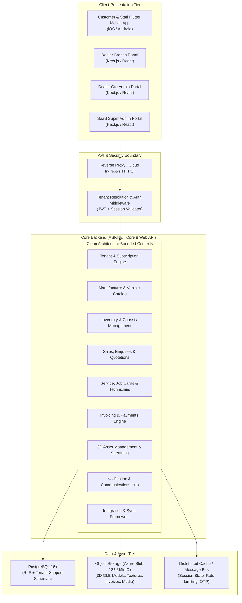
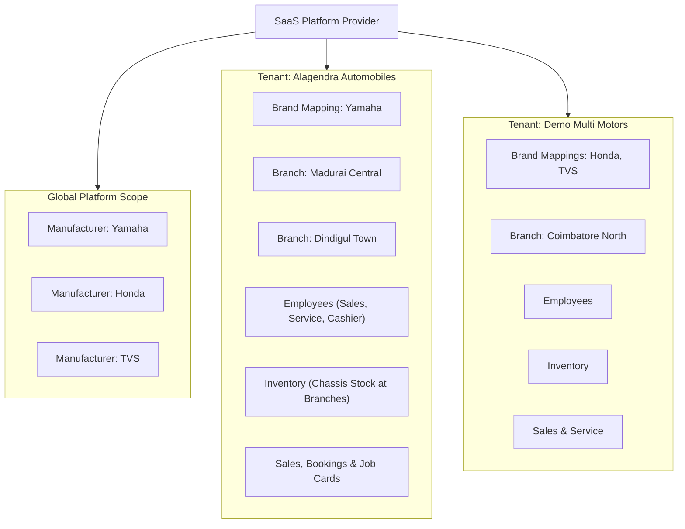
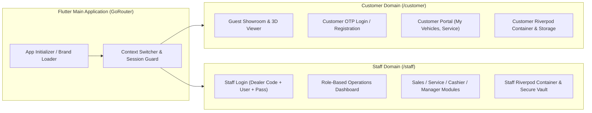

# System Architecture: MotoSaaS Multi-Tenant Platform

This document describes the high-level architecture of the Multi-Tenant Two-Wheeler Dealership Management SaaS platform.

---

## 1. Architectural Philosophy & Principles

1. **Modular Monolith First:** Built as a single deployable ASP.NET Core 8 Web API with strictly isolated internal modules (bounded contexts) using Clean Architecture. Microservices are rejected at this stage to prevent premature network latency, distributed transaction complexity, and excessive operational cost.
2. **Strict Multi-Tenancy by Design:** The system is tenant-aware from the database layer to the presentation layer. No data is stored without explicit tenant ownership.
3. **Decoupled Business Entities:** 
   - `Manufacturer` (e.g., Yamaha, Honda, TVS, EV startups) is independent of any dealership.
   - `Dealership Organization` (`Tenant`, e.g., Alagendra Automobiles) is an independent business entity.
   - `Branch` is a physical operational location under a dealership organization.
4. **Dual-Experience Mobile Application:** A single Flutter application delivers a guest/customer experience and a staff operational portal with strict runtime, token, and cache isolation.
5. **Real 3D Interactive Showroom:** Realistic GLB/glTF 3D vehicle visualization with dynamic variant/color switches and graceful multi-tier fallbacks.

---

## 2. High-Level System Architecture Diagram



---

## 3. Tenancy Hierarchy & Isolation Model



### Data Isolation Guarantees
1. **Server-Side Identity:** The tenant context (`TenantId`) is extracted exclusively from the authenticated JWT claims on protected routes or resolved via domain/header on public white-labeled endpoints. Client-supplied `tenant_id` in request bodies is never trusted for authorization.
2. **EF Core Global Query Filters:**
   ```csharp
   modelBuilder.Entity<InventoryItem>()
       .HasQueryFilter(e => e.TenantId == _currentTenantService.TenantId);
   ```
3. **PostgreSQL Row-Level Security (RLS):**
   ```sql
   ALTER TABLE inventory_items ENABLE ROW LEVEL SECURITY;
   CREATE POLICY tenant_isolation_policy ON inventory_items
       FOR ALL
       USING (tenant_id = current_setting('app.current_tenant_id')::uuid);
   ```
4. **Branch Authorization:** For branch-scoped entities (e.g., job cards, inventory allocation), the backend verifies that the acting user has role assignment to that specific `BranchId` within the authenticated `TenantId`.

---

## 4. Dual-Experience Mobile Client Architecture (Flutter)

The single Flutter application cleanly isolates Customer and Staff domains:



- **Zero Cache Leakage:** On switching modes or logging out, an explicit `PurgeSessionUseCase` purges JWT tokens, user profiles, secure storage keys, and Dio client headers for that domain.

---

## 5. Backend Clean Architecture Layout

The ASP.NET Core solution is partitioned into four clear layers per bounded context:

```
src/
├── MotoSaaS.Domain/             # Pure enterprise business entities, value objects, domain events, enums
├── MotoSaaS.Application/        # Use cases, CQRS commands/queries, FluentValidation, DTOs, interfaces
├── MotoSaaS.Infrastructure/     # EF Core DbContext, PostgreSQL configs, RLS interceptors, Blob storage, Email/SMS
├── MotoSaaS.Api/                # Controllers, Middlewares, Filters, OpenAPI Swagger, Dependency Injection
└── MotoSaaS.Seeder/             # Centralized deterministic demo data seeding CLI
```

---

## 6. Integration Architecture

Dealerships frequently utilize upstream manufacturer systems or local accounting software. The integration engine provides an adapter-based framework:
- **`IDmsAdapter`:** Synchronization of vehicle catalog, dispatched chassis, and warranty registrations.
- **`IAccountingAdapter`:** Export of daily invoice journals, ledger postings, and tax summaries (Tally / Zoho Books / QuickBooks compatible).
- **`IPaymentGatewayAdapter`:** Idempotent processing of customer booking deposits and service payments.
- **`ICommunicationAdapter`:** SMS and WhatsApp delivery with delivery receipt logging.

