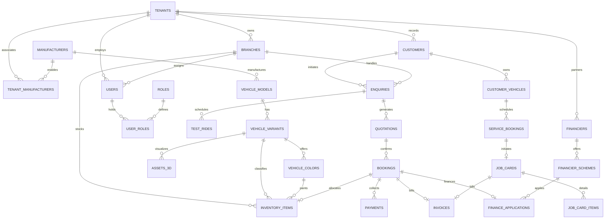

# Database Design: MotoSaaS Multi-Tenant Two-Wheeler Platform

This document specifies the PostgreSQL 16+ relational schema, indexing strategies, tenancy scoping, and concurrency controls for the platform.

---

## 1. Database Conventions & Standards

1. **Naming Conventions:** All tables, columns, indexes, and constraints use `snake_case`. Table names are pluralized (`tenants`, `branches`, `inventory_items`).
2. **Primary Keys:** Every table uses a `uuid` primary key (`id UUID PRIMARY KEY DEFAULT gen_random_uuid()`).
3. **Tenant Scoping:** All tenant-owned tables MUST include `tenant_id UUID NOT NULL REFERENCES tenants(id) ON DELETE CASCADE`.
4. **Branch Scoping:** Operational tables tied to physical branch sites include `branch_id UUID NOT NULL REFERENCES branches(id)`.
5. **Auditing Columns:** Every entity includes:
   - `created_at TIMESTAMPTZ NOT NULL DEFAULT clock_timestamp()`
   - `updated_at TIMESTAMPTZ NOT NULL DEFAULT clock_timestamp()`
   - `created_by UUID NULL`
   - `updated_by UUID NULL`
   - `is_deleted BOOLEAN NOT NULL DEFAULT FALSE` (Soft delete for auditable records)
6. **Concurrency Control:** Critical inventory and booking records use `xmin` / `concurrency_version INT NOT NULL DEFAULT 1` for optimistic locking.

---

## 2. Core Entity-Relationship Diagram



---

## 3. Detailed Table Specifications

### A. Tenancy & Staff Hierarchy

```sql
-- 1. Tenants (Dealership Organizations)
CREATE TABLE tenants (
    id UUID PRIMARY KEY DEFAULT gen_random_uuid(),
    code VARCHAR(50) NOT NULL UNIQUE,          -- e.g., 'ALAGENDRA'
    legal_name VARCHAR(255) NOT NULL,
    trade_name VARCHAR(255) NOT NULL,
    tax_id VARCHAR(50),                        -- GSTIN / Tax ID
    logo_url TEXT,
    primary_color VARCHAR(10) DEFAULT '#002C6C',
    secondary_color VARCHAR(10) DEFAULT '#E60012',
    status VARCHAR(30) NOT NULL DEFAULT 'ACTIVE', -- ACTIVE, SUSPENDED, TRIAL
    created_at TIMESTAMPTZ NOT NULL DEFAULT clock_timestamp(),
    updated_at TIMESTAMPTZ NOT NULL DEFAULT clock_timestamp()
);

-- 2. Branches
CREATE TABLE branches (
    id UUID PRIMARY KEY DEFAULT gen_random_uuid(),
    tenant_id UUID NOT NULL REFERENCES tenants(id) ON DELETE CASCADE,
    code VARCHAR(50) NOT NULL,                 -- e.g., 'MDU-CTR'
    name VARCHAR(255) NOT NULL,
    address_line1 TEXT NOT NULL,
    city VARCHAR(100) NOT NULL,
    state VARCHAR(100) NOT NULL,
    postal_code VARCHAR(20) NOT NULL,
    phone VARCHAR(30) NOT NULL,
    email VARCHAR(255),
    is_headquarters BOOLEAN NOT NULL DEFAULT FALSE,
    is_active BOOLEAN NOT NULL DEFAULT TRUE,
    created_at TIMESTAMPTZ NOT NULL DEFAULT clock_timestamp(),
    updated_at TIMESTAMPTZ NOT NULL DEFAULT clock_timestamp(),
    CONSTRAINT uq_branch_tenant_code UNIQUE (tenant_id, code)
);

-- 3. Users (Staff & Admin)
CREATE TABLE users (
    id UUID PRIMARY KEY DEFAULT gen_random_uuid(),
    tenant_id UUID REFERENCES tenants(id) ON DELETE CASCADE, -- NULL for SaaS Super Admin
    default_branch_id UUID REFERENCES branches(id),
    username VARCHAR(100) NOT NULL,
    email VARCHAR(255) NOT NULL,
    phone VARCHAR(30) NOT NULL,
    password_hash VARCHAR(255) NOT NULL,
    full_name VARCHAR(255) NOT NULL,
    user_type VARCHAR(30) NOT NULL,           -- SAAS_ADMIN, DEALER_STAFF, CUSTOMER
    is_active BOOLEAN NOT NULL DEFAULT TRUE,
    created_at TIMESTAMPTZ NOT NULL DEFAULT clock_timestamp(),
    updated_at TIMESTAMPTZ NOT NULL DEFAULT clock_timestamp(),
    CONSTRAINT uq_user_email UNIQUE (email),
    CONSTRAINT uq_user_tenant_username UNIQUE (tenant_id, username)
);
```

### B. Manufacturer & Global Vehicle Catalog

```sql
-- 4. Manufacturers
CREATE TABLE manufacturers (
    id UUID PRIMARY KEY DEFAULT gen_random_uuid(),
    code VARCHAR(50) NOT NULL UNIQUE,          -- 'YAMAHA', 'HONDA', 'TVS'
    name VARCHAR(100) NOT NULL,
    logo_url TEXT,
    country_of_origin VARCHAR(100),
    is_active BOOLEAN NOT NULL DEFAULT TRUE,
    created_at TIMESTAMPTZ NOT NULL DEFAULT clock_timestamp()
);

-- 5. Tenant Manufacturer Association (M:N)
CREATE TABLE tenant_manufacturers (
    tenant_id UUID NOT NULL REFERENCES tenants(id) ON DELETE CASCADE,
    manufacturer_id UUID NOT NULL REFERENCES manufacturers(id) ON DELETE RESTRICT,
    dealer_code_with_oem VARCHAR(100),
    is_primary BOOLEAN NOT NULL DEFAULT FALSE,
    created_at TIMESTAMPTZ NOT NULL DEFAULT clock_timestamp(),
    PRIMARY KEY (tenant_id, manufacturer_id)
);

-- 6. Vehicle Models
CREATE TABLE vehicle_models (
    id UUID PRIMARY KEY DEFAULT gen_random_uuid(),
    manufacturer_id UUID NOT NULL REFERENCES manufacturers(id),
    code VARCHAR(50) NOT NULL,                 -- 'YZF-R15', 'AEROX-155'
    name VARCHAR(150) NOT NULL,
    category VARCHAR(50) NOT NULL,             -- MOTORCYCLE, SCOOTER, EV
    fuel_type VARCHAR(30) NOT NULL,            -- PETROL, ELECTRIC, HYBRID
    displacement_cc INT,
    battery_capacity_kwh NUMERIC(5,2),
    is_active BOOLEAN NOT NULL DEFAULT TRUE,
    created_at TIMESTAMPTZ NOT NULL DEFAULT clock_timestamp()
);

-- 7. Vehicle Variants
CREATE TABLE vehicle_variants (
    id UUID PRIMARY KEY DEFAULT gen_random_uuid(),
    model_id UUID NOT NULL REFERENCES vehicle_models(id) ON DELETE CASCADE,
    code VARCHAR(50) NOT NULL,                 -- 'R15-V4-M', 'R15-V4-STD'
    name VARCHAR(150) NOT NULL,
    base_price NUMERIC(12,2) NOT NULL,         -- Indicative Ex-Showroom
    specifications_json JSONB NOT NULL,
    features_json JSONB NOT NULL,
    is_active BOOLEAN NOT NULL DEFAULT TRUE,
    created_at TIMESTAMPTZ NOT NULL DEFAULT clock_timestamp()
);

-- 8. Vehicle Colors & Media
CREATE TABLE vehicle_colors (
    id UUID PRIMARY KEY DEFAULT gen_random_uuid(),
    variant_id UUID NOT NULL REFERENCES vehicle_variants(id) ON DELETE CASCADE,
    color_name VARCHAR(100) NOT NULL,          -- 'Racing Blue', 'Metallic Red'
    hex_code VARCHAR(10) NOT NULL,             -- '#002C6C'
    is_primary BOOLEAN NOT NULL DEFAULT FALSE,
    image_url TEXT,
    created_at TIMESTAMPTZ NOT NULL DEFAULT clock_timestamp()
);

-- 9. 3D Showroom Assets
CREATE TABLE assets_3d (
    id UUID PRIMARY KEY DEFAULT gen_random_uuid(),
    variant_id UUID NOT NULL REFERENCES vehicle_variants(id) ON DELETE CASCADE,
    color_id UUID REFERENCES vehicle_colors(id) ON DELETE SET NULL,
    glb_file_url TEXT NOT NULL,
    usdz_file_url TEXT,                        -- iOS AR QuickLook
    model_file_size_bytes BIGINT NOT NULL,
    hotspots_json JSONB,
    camera_presets_json JSONB,
    is_active BOOLEAN NOT NULL DEFAULT TRUE,
    created_at TIMESTAMPTZ NOT NULL DEFAULT clock_timestamp()
);
```

### C. Inventory & Allocation Management

```sql
-- 10. Inventory Items (Physical Chassis Units)
CREATE TABLE inventory_items (
    id UUID PRIMARY KEY DEFAULT gen_random_uuid(),
    tenant_id UUID NOT NULL REFERENCES tenants(id) ON DELETE CASCADE,
    branch_id UUID NOT NULL REFERENCES branches(id) ON DELETE RESTRICT,
    variant_id UUID NOT NULL REFERENCES vehicle_variants(id),
    color_id UUID NOT NULL REFERENCES vehicle_colors(id),
    chassis_number VARCHAR(100) NOT NULL,      -- VIN / Frame No
    engine_number VARCHAR(100) NOT NULL,
    status VARCHAR(30) NOT NULL DEFAULT 'AVAILABLE', 
    -- EXPECTED, RECEIVED, AVAILABLE, RESERVED, ALLOCATED, SOLD, DELIVERED
    manufacturing_date DATE,
    received_date DATE,
    purchase_cost NUMERIC(12,2),
    concurrency_version INT NOT NULL DEFAULT 1,
    created_at TIMESTAMPTZ NOT NULL DEFAULT clock_timestamp(),
    updated_at TIMESTAMPTZ NOT NULL DEFAULT clock_timestamp(),
    CONSTRAINT uq_chassis_per_tenant UNIQUE (tenant_id, chassis_number)
);

-- 11. Inventory Movement Audit Log
CREATE TABLE inventory_movements (
    id UUID PRIMARY KEY DEFAULT gen_random_uuid(),
    tenant_id UUID NOT NULL REFERENCES tenants(id),
    inventory_item_id UUID NOT NULL REFERENCES inventory_items(id),
    from_branch_id UUID REFERENCES branches(id),
    to_branch_id UUID REFERENCES branches(id),
    from_status VARCHAR(30) NOT NULL,
    to_status VARCHAR(30) NOT NULL,
    performed_by UUID NOT NULL REFERENCES users(id),
    notes TEXT,
    created_at TIMESTAMPTZ NOT NULL DEFAULT clock_timestamp()
);
```

### D. Sales, CRM & Delivery Lifecycle

```sql
-- 12. Customers
CREATE TABLE customers (
    id UUID PRIMARY KEY DEFAULT gen_random_uuid(),
    tenant_id UUID NOT NULL REFERENCES tenants(id) ON DELETE CASCADE,
    first_name VARCHAR(100) NOT NULL,
    last_name VARCHAR(100),
    phone VARCHAR(30) NOT NULL,
    email VARCHAR(255),
    address_line1 TEXT,
    city VARCHAR(100),
    state VARCHAR(100),
    postal_code VARCHAR(20),
    created_at TIMESTAMPTZ NOT NULL DEFAULT clock_timestamp(),
    CONSTRAINT uq_customer_phone_per_tenant UNIQUE (tenant_id, phone)
);

-- 13. Enquiries (Leads)
CREATE TABLE enquiries (
    id UUID PRIMARY KEY DEFAULT gen_random_uuid(),
    tenant_id UUID NOT NULL REFERENCES tenants(id) ON DELETE CASCADE,
    branch_id UUID NOT NULL REFERENCES branches(id),
    customer_id UUID NOT NULL REFERENCES customers(id),
    variant_id UUID NOT NULL REFERENCES vehicle_variants(id),
    assigned_sales_exec_id UUID REFERENCES users(id),
    status VARCHAR(30) NOT NULL DEFAULT 'NEW',  -- NEW, CONTACTED, TEST_RIDE, QUOTED, BOOKED, LOST
    source VARCHAR(50) NOT NULL DEFAULT 'WALK_IN', -- WALK_IN, MOBILE_APP, WEB, PHONE
    expected_purchase_date DATE,
    notes TEXT,
    created_at TIMESTAMPTZ NOT NULL DEFAULT clock_timestamp(),
    updated_at TIMESTAMPTZ NOT NULL DEFAULT clock_timestamp()
);

-- 14. Test Rides
CREATE TABLE test_rides (
    id UUID PRIMARY KEY DEFAULT gen_random_uuid(),
    tenant_id UUID NOT NULL REFERENCES tenants(id),
    branch_id UUID NOT NULL REFERENCES branches(id),
    enquiry_id UUID NOT NULL REFERENCES enquiries(id),
    customer_id UUID NOT NULL REFERENCES customers(id),
    variant_id UUID NOT NULL REFERENCES vehicle_variants(id),
    scheduled_at TIMESTAMPTZ NOT NULL,
    completed_at TIMESTAMPTZ,
    status VARCHAR(30) NOT NULL DEFAULT 'SCHEDULED', -- SCHEDULED, COMPLETED, CANCELLED, NO_SHOW
    driving_license_number VARCHAR(100),
    feedback_notes TEXT,
    created_at TIMESTAMPTZ NOT NULL DEFAULT clock_timestamp()
);

-- 15. Quotations
CREATE TABLE quotations (
    id UUID PRIMARY KEY DEFAULT gen_random_uuid(),
    tenant_id UUID NOT NULL REFERENCES tenants(id),
    branch_id UUID NOT NULL REFERENCES branches(id),
    quotation_number VARCHAR(50) NOT NULL,
    enquiry_id UUID REFERENCES enquiries(id),
    customer_id UUID NOT NULL REFERENCES customers(id),
    variant_id UUID NOT NULL REFERENCES vehicle_variants(id),
    color_id UUID NOT NULL REFERENCES vehicle_colors(id),
    ex_showroom_price NUMERIC(12,2) NOT NULL,
    rto_charges NUMERIC(12,2) NOT NULL DEFAULT 0.00,
    insurance_charges NUMERIC(12,2) NOT NULL DEFAULT 0.00,
    accessories_charges NUMERIC(12,2) NOT NULL DEFAULT 0.00,
    discount_amount NUMERIC(12,2) NOT NULL DEFAULT 0.00,
    total_on_road_price NUMERIC(12,2) NOT NULL,
    valid_until DATE NOT NULL,
    status VARCHAR(30) NOT NULL DEFAULT 'ACTIVE', -- ACTIVE, CONVERTED, EXPIRED
    created_at TIMESTAMPTZ NOT NULL DEFAULT clock_timestamp(),
    CONSTRAINT uq_quotation_tenant_number UNIQUE (tenant_id, quotation_number)
);

-- 16. Bookings
CREATE TABLE bookings (
    id UUID PRIMARY KEY DEFAULT gen_random_uuid(),
    tenant_id UUID NOT NULL REFERENCES tenants(id),
    branch_id UUID NOT NULL REFERENCES branches(id),
    booking_number VARCHAR(50) NOT NULL,
    quotation_id UUID REFERENCES quotations(id),
    customer_id UUID NOT NULL REFERENCES customers(id),
    variant_id UUID NOT NULL REFERENCES vehicle_variants(id),
    color_id UUID NOT NULL REFERENCES vehicle_colors(id),
    allocated_inventory_id UUID REFERENCES inventory_items(id), -- Null until allocated
    booking_amount NUMERIC(12,2) NOT NULL,
    total_price NUMERIC(12,2) NOT NULL,
    balance_amount NUMERIC(12,2) NOT NULL,
    status VARCHAR(30) NOT NULL DEFAULT 'CONFIRMED', -- CONFIRMED, ALLOCATED, DELIVERED, CANCELLED
    created_at TIMESTAMPTZ NOT NULL DEFAULT clock_timestamp(),
    updated_at TIMESTAMPTZ NOT NULL DEFAULT clock_timestamp(),
    CONSTRAINT uq_booking_tenant_number UNIQUE (tenant_id, booking_number)
);

-- 17. Invoices
CREATE TABLE invoices (
    id UUID PRIMARY KEY DEFAULT gen_random_uuid(),
    tenant_id UUID NOT NULL REFERENCES tenants(id),
    branch_id UUID NOT NULL REFERENCES branches(id),
    invoice_number VARCHAR(50) NOT NULL,
    invoice_type VARCHAR(30) NOT NULL,         -- VEHICLE_SALE, SERVICE, SPARE_PARTS
    booking_id UUID REFERENCES bookings(id),
    job_card_id UUID,                          -- Attached to service job card
    customer_id UUID NOT NULL REFERENCES customers(id),
    subtotal NUMERIC(12,2) NOT NULL,
    tax_amount NUMERIC(12,2) NOT NULL,
    total_amount NUMERIC(12,2) NOT NULL,
    status VARCHAR(30) NOT NULL DEFAULT 'ISSUED', -- ISSUED, PAID, CANCELLED
    created_at TIMESTAMPTZ NOT NULL DEFAULT clock_timestamp(),
    CONSTRAINT uq_invoice_tenant_number UNIQUE (tenant_id, invoice_number)
);

-- 18. Payments
CREATE TABLE payments (
    id UUID PRIMARY KEY DEFAULT gen_random_uuid(),
    tenant_id UUID NOT NULL REFERENCES tenants(id),
    branch_id UUID NOT NULL REFERENCES branches(id),
    receipt_number VARCHAR(50) NOT NULL,
    booking_id UUID REFERENCES bookings(id),
    invoice_id UUID REFERENCES invoices(id),
    amount NUMERIC(12,2) NOT NULL,
    payment_mode VARCHAR(30) NOT NULL,         -- CASH, UPI, CARD, NET_BANKING, FINANCIER
    transaction_ref VARCHAR(100),
    collected_by UUID NOT NULL REFERENCES users(id),
    paid_at TIMESTAMPTZ NOT NULL DEFAULT clock_timestamp(),
    status VARCHAR(30) NOT NULL DEFAULT 'SUCCESS',
    created_at TIMESTAMPTZ NOT NULL DEFAULT clock_timestamp()
);

-- 18a. Financiers (Partner Banks & NBFCs)
CREATE TABLE financiers (
    id UUID PRIMARY KEY DEFAULT gen_random_uuid(),
    tenant_id UUID NOT NULL REFERENCES tenants(id) ON DELETE CASCADE,
    code VARCHAR(50) NOT NULL,                 -- 'HDFC', 'TVS_CREDIT', 'LT_FINANCE'
    name VARCHAR(150) NOT NULL,
    contact_person VARCHAR(100),
    phone VARCHAR(30),
    email VARCHAR(255),
    is_active BOOLEAN NOT NULL DEFAULT TRUE,
    created_at TIMESTAMPTZ NOT NULL DEFAULT clock_timestamp(),
    CONSTRAINT uq_financier_tenant_code UNIQUE (tenant_id, code)
);

-- 18b. Financier Schemes
CREATE TABLE financier_schemes (
    id UUID PRIMARY KEY DEFAULT gen_random_uuid(),
    tenant_id UUID NOT NULL REFERENCES tenants(id) ON DELETE CASCADE,
    financier_id UUID NOT NULL REFERENCES financiers(id) ON DELETE CASCADE,
    scheme_name VARCHAR(150) NOT NULL,         -- 'Low Interest Special', 'Zero Down Payment'
    interest_rate_apr NUMERIC(5,2) NOT NULL,   -- e.g., 9.50%
    interest_type VARCHAR(30) NOT NULL DEFAULT 'REDUCING', -- REDUCING, FLAT
    min_down_payment_percent NUMERIC(5,2) NOT NULL DEFAULT 15.00,
    max_ltv_percent NUMERIC(5,2) NOT NULL DEFAULT 85.00,
    allowed_tenures_months INT[] NOT NULL,     -- ARRAY[12, 18, 24, 36, 48, 60]
    processing_fee_percent NUMERIC(5,2) DEFAULT 1.50,
    processing_fee_flat NUMERIC(10,2) DEFAULT 0.00,
    documentation_charges NUMERIC(10,2) DEFAULT 500.00,
    is_active BOOLEAN NOT NULL DEFAULT TRUE,
    valid_from DATE NOT NULL,
    valid_until DATE,
    created_at TIMESTAMPTZ NOT NULL DEFAULT clock_timestamp()
);

-- 18c. Finance Applications
CREATE TABLE finance_applications (
    id UUID PRIMARY KEY DEFAULT gen_random_uuid(),
    tenant_id UUID NOT NULL REFERENCES tenants(id) ON DELETE CASCADE,
    branch_id UUID NOT NULL REFERENCES branches(id),
    booking_id UUID NOT NULL REFERENCES bookings(id) ON DELETE CASCADE,
    financier_id UUID NOT NULL REFERENCES financiers(id),
    scheme_id UUID REFERENCES financier_schemes(id),
    loan_amount NUMERIC(12,2) NOT NULL,
    down_payment_amount NUMERIC(12,2) NOT NULL,
    tenure_months INT NOT NULL,
    interest_rate_apr NUMERIC(5,2) NOT NULL,
    calculated_monthly_emi NUMERIC(10,2) NOT NULL,
    processing_fee NUMERIC(10,2) NOT NULL DEFAULT 0.00,
    status VARCHAR(30) NOT NULL DEFAULT 'APPLIED', 
    -- APPLIED, DOCS_SUBMITTED, UNDER_REVIEW, APPROVED, REJECTED, DISBURSED
    loan_account_number VARCHAR(100),
    approval_reference VARCHAR(100),
    disbursed_at TIMESTAMPTZ,
    notes TEXT,
    created_at TIMESTAMPTZ NOT NULL DEFAULT clock_timestamp(),
    updated_at TIMESTAMPTZ NOT NULL DEFAULT clock_timestamp()
);
```

### E. Service, Maintenance & Job Cards

```sql
-- 19. Customer Vehicles (Ownership)
CREATE TABLE customer_vehicles (
    id UUID PRIMARY KEY DEFAULT gen_random_uuid(),
    tenant_id UUID NOT NULL REFERENCES tenants(id),
    customer_id UUID NOT NULL REFERENCES customers(id),
    variant_id UUID NOT NULL REFERENCES vehicle_variants(id),
    registration_number VARCHAR(50) NOT NULL,  -- License plate
    chassis_number VARCHAR(100) NOT NULL,
    engine_number VARCHAR(100),
    delivery_date DATE,
    created_at TIMESTAMPTZ NOT NULL DEFAULT clock_timestamp(),
    CONSTRAINT uq_cust_veh_reg UNIQUE (tenant_id, registration_number)
);

-- 20. Service Bookings
CREATE TABLE service_bookings (
    id UUID PRIMARY KEY DEFAULT gen_random_uuid(),
    tenant_id UUID NOT NULL REFERENCES tenants(id),
    branch_id UUID NOT NULL REFERENCES branches(id),
    customer_vehicle_id UUID NOT NULL REFERENCES customer_vehicles(id),
    service_type VARCHAR(50) NOT NULL,         -- FREE_SERVICE_1, PAID_GENERAL, REPAIR, ACCIDENT
    scheduled_date DATE NOT NULL,
    time_slot VARCHAR(30) NOT NULL,            -- '09:00 - 10:00'
    customer_complaints TEXT,
    status VARCHAR(30) NOT NULL DEFAULT 'BOOKED', -- BOOKED, RECEIVED, IN_SERVICE, READY, DELIVERED
    created_at TIMESTAMPTZ NOT NULL DEFAULT clock_timestamp()
);

-- 21. Job Cards
CREATE TABLE job_cards (
    id UUID PRIMARY KEY DEFAULT gen_random_uuid(),
    tenant_id UUID NOT NULL REFERENCES tenants(id),
    branch_id UUID NOT NULL REFERENCES branches(id),
    job_card_number VARCHAR(50) NOT NULL,
    service_booking_id UUID REFERENCES service_bookings(id),
    customer_vehicle_id UUID NOT NULL REFERENCES customer_vehicles(id),
    service_advisor_id UUID NOT NULL REFERENCES users(id),
    technician_id UUID REFERENCES users(id),
    odometer_reading INT NOT NULL,
    fuel_level_percent INT NOT NULL,
    estimated_cost NUMERIC(12,2) NOT NULL DEFAULT 0.00,
    customer_approved BOOLEAN NOT NULL DEFAULT FALSE,
    status VARCHAR(30) NOT NULL DEFAULT 'OPEN', -- OPEN, ESTIMATED, APPROVED, WIP, QC_DONE, BILLED, CLOSED
    created_at TIMESTAMPTZ NOT NULL DEFAULT clock_timestamp(),
    updated_at TIMESTAMPTZ NOT NULL DEFAULT clock_timestamp(),
    CONSTRAINT uq_job_card_tenant_number UNIQUE (tenant_id, job_card_number)
);

-- 22. Job Card Items (Parts & Labour)
CREATE TABLE job_card_items (
    id UUID PRIMARY KEY DEFAULT gen_random_uuid(),
    job_card_id UUID NOT NULL REFERENCES job_cards(id) ON DELETE CASCADE,
    item_type VARCHAR(30) NOT NULL,            -- LABOUR, SPARE_PART, CONSUMABLE
    description VARCHAR(255) NOT NULL,
    quantity NUMERIC(8,2) NOT NULL DEFAULT 1.00,
    unit_price NUMERIC(12,2) NOT NULL,
    total_price NUMERIC(12,2) NOT NULL,
    is_approved BOOLEAN NOT NULL DEFAULT TRUE,
    created_at TIMESTAMPTZ NOT NULL DEFAULT clock_timestamp()
);
```

---

## 4. PostgreSQL Row-Level Security (RLS) Implementation

To ensure non-negotiable tenant isolation even in cases of application logic defects, Row-Level Security is enabled across all tenant-scoped tables:

```sql
-- Step 1: Enable RLS on all tenant-owned tables
ALTER TABLE branches ENABLE ROW LEVEL SECURITY;
ALTER TABLE inventory_items ENABLE ROW LEVEL SECURITY;
ALTER TABLE customers ENABLE ROW LEVEL SECURITY;
ALTER TABLE enquiries ENABLE ROW LEVEL SECURITY;
ALTER TABLE test_rides ENABLE ROW LEVEL SECURITY;
ALTER TABLE quotations ENABLE ROW LEVEL SECURITY;
ALTER TABLE bookings ENABLE ROW LEVEL SECURITY;
ALTER TABLE invoices ENABLE ROW LEVEL SECURITY;
ALTER TABLE payments ENABLE ROW LEVEL SECURITY;
ALTER TABLE financiers ENABLE ROW LEVEL SECURITY;
ALTER TABLE financier_schemes ENABLE ROW LEVEL SECURITY;
ALTER TABLE finance_applications ENABLE ROW LEVEL SECURITY;
ALTER TABLE customer_vehicles ENABLE ROW LEVEL SECURITY;
ALTER TABLE service_bookings ENABLE ROW LEVEL SECURITY;
ALTER TABLE job_cards ENABLE ROW LEVEL SECURITY;

-- Step 2: Establish Tenant Isolation Policy Template
CREATE POLICY tenant_isolation_policy ON inventory_items
    FOR ALL
    USING (
        tenant_id = NULLIF(current_setting('app.current_tenant_id', true), '')::UUID
        OR current_setting('app.is_saas_super_admin', true) = 'true'
    );
```

