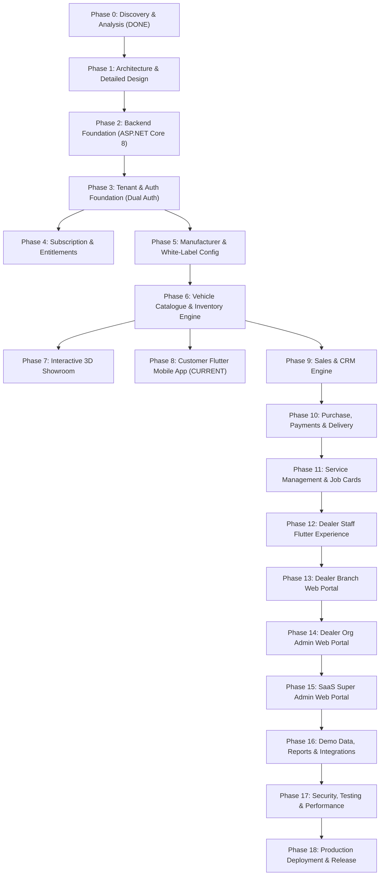

# Implementation Plan: Multi-Tenant Two-Wheeler Dealership Management SaaS

This plan governs the engineering lifecycle of the platform across 18 sequential phases, adhering strictly to phased approval gates and DoD standards.

---

## Phase Overview & Dependency Graph

---

## Detailed Phase Breakdown

### Phase 0: Repository Analysis & Product Discovery
- **Scope:** Complete analysis of existing repository, runtimes, product boundaries, tenancy model, module architecture, database schemas, workflows, and risk registers.
- **Deliverables:** Root documentation (`PROJECT_STATUS.md`, `IMPLEMENTATION_PLAN.md`, `ARCHITECTURE.md`, `DATABASE_DESIGN.md`, `API_CONTRACTS.md`, `DECISIONS.md`, `KNOWN_ISSUES.md`, `CHANGELOG.md`) and in-depth specs in `docs/`.
- **Gate:** STOP and obtain explicit user approval.

### Phase 1: Architecture & Detailed Design
- **Scope:** Formalize system architecture, complete database ERD with PostgreSQL constraints, API schemas, authorization matrices, 3D asset specifications, and demo data contracts.
- **Deliverables:** Architectural diagrams, OpenAPI 3.1 specification, migration plans.
- **Gate:** STOP and obtain explicit user approval.

### Phase 2: Backend Foundation
- **Scope:** Establish ASP.NET Core 8 Web API modular monolith structure with Clean Architecture (`Api`, `Application`, `Domain`, `Infrastructure`), EF Core 8 setup, Npgsql PostgreSQL provider, Serilog structured logging, FluentValidation pipeline, and global exception handling.
- **Deliverables:** Compiling, runnable backend project with Swagger/OpenAPI UI and health checks.

### Phase 3: Tenant & Authentication Foundation
- **Scope:** Multi-tenant resolution middleware, tenant context accessor, database global query filters, dual authentication architecture:
  - Customer: Mobile number + OTP token generation and verification.
  - Staff: Dealer code + Username/Email + Password + JWT with refresh tokens.
  - Role-based and claim-based authorization policies (`StaffOnly`, `CustomerOnly`, `BranchManager`, etc.).
- **Deliverables:** Auth endpoints with unit and integration tests verifying strict privilege separation.

### Phase 4: Subscription & Entitlements
- **Scope:** SaaS subscription tiers (Starter, Professional, Enterprise), module feature toggles, usage limits (branch count, employee count, storage limits), trial duration enforcement.
- **Deliverables:** Tenant entitlement engine and guard middlewares.

### Phase 5: Manufacturer & White-Label Configuration
- **Scope:** Decoupled Manufacturer entity, tenant-to-manufacturer M:N mappings, organization branding (logo, primary/secondary colors, name, contact info), branch-level configuration and overrides.
- **Deliverables:** Configuration APIs and white-label theme payloads.

### Phase 6: Vehicle Catalogue & Inventory Engine
- **Scope:** Two-wheeler catalog (Motorcycles, Scooters, EVs) with models, variants, specifications, battery specs, colors, and media assets. Real inventory state machine (`Expected` -> `Received` -> `Available` -> `Reserved` -> `Allocated` -> `Sold` -> `Delivered`) with chassis/engine number tracking and concurrency locks.
- **Deliverables:** Catalog and Inventory management APIs with transaction safety.

### Phase 7: Interactive 3D Showroom
- **Scope:** Three.js / React Three Fiber interactive viewer for Web and WebGL / Flutter viewer for mobile. GLB/glTF loading, 360-degree horizontal rotation, camera controls (zoom, reset, preset viewpoints), variant and color switching, interactive hotspots, and 360-degree image fallback pipeline.
- **Deliverables:** Functional 3D viewer component and asset management APIs.

### Phase 8: Customer Flutter Mobile Application
- **Scope:** Riverpod 3.x Clean Architecture Flutter app:
  - Guest vehicle discovery and catalog browsing.
  - 3D interactive vehicle showroom integration.
  - Vehicle comparison and branch pricing.
  - Enquiry and test ride booking requests.
  - Customer OTP login and profile.
  - "My Vehicles" ownership, service booking, and service progress tracking.
- **Deliverables:** Complete customer mobile flow.
- **Status:** Completed 2026-11-13 — `mobile/customer_app`; see `docs/api/PHASE_8_CUSTOMER_APP.md` and `docs/ui-ux/CUSTOMER_APP_UX.md`.

### Phase 9: Sales & CRM Engine
- **Scope:** Lead capture and automated branch assignment, sales executive follow-ups, test ride scheduling and completion verification, dynamic quotation engine (base price, accessories, RTO, insurance, road tax, discounts).
- **Deliverables:** Sales pipeline backend and branch CRM endpoints.
- **Status:** Completed 2026-11-13 — `/api/v1/staff/sales` CRM and `/api/v1/quotations` engine; migration `20261113175619_Phase9SalesCrm`; 171 backend tests and 62-assertion E2E; see `docs/api/PHASE_9_SALES_CRM.md`.

### Phase 10: Purchase, Payments & Delivery
- **Scope:** Booking confirmation, payment collection (cash, card, UPI, bank transfer, finance), partial payment balance tracking, physical chassis allocation, automated invoice generation (DEMO-labeled for pilot), vehicle pre-delivery inspection (PDI), and customer handover record.
- **Deliverables:** Financial and inventory delivery workflows.
- **Status:** Completed 2026-11-14 — `/api/v1/bookings`, `/api/v1/billing/payments`, `/api/v1/inventory/allocate`, `/api/v1/billing/invoices/generate`, `/api/v1/bookings/{id}/inspection`, `/api/v1/bookings/{id}/handover`; 11 unit tests (`PurchaseServiceTests`, `PurchaseControllerTests`).

### Phase 11: Service Management & Job Cards
- **Scope:** Service booking, customer vehicle reception, digital job card creation, inspection checklist, labour and spare parts estimation, customer approval workflow, technician assignment, quality check, service invoice generation, and customer feedback.
- **Deliverables:** Service operations engine and tracking APIs.
- **Status:** Completed 2026-11-14 — `/api/v1/service/job-cards`, `/api/v1/service/technicians`, estimates, QC check, billing, customer feedback; 6 unit tests (`ServiceWorkshopControllerTests`).

### Phase 12: Dealer Staff Flutter Experience
- **Scope:** Staff portal mode within the Flutter app:
  - Role-adaptive dashboard for Sales Executive, Service Advisor, Technician, Cashier, and Branch Manager.
  - Immediate lead processing, test ride scheduling, job card updates, inspection checklist input, payment receipting.
  - Strict local cache and session partitioning from customer mode.
- **Deliverables:** Mobile dealer workflow.
- **Status:** Completed 2026-11-14 — `StaffPage` in `mobile/customer_app`, linked from profile screen, role-adaptive workspace, 35 passing Flutter unit tests.

### Phase 13: Dealer Branch Management Portal
- **Scope:** Next.js / TypeScript web application for branch-level day-to-day operations:
  - Sales pipelines, quotation generation, inventory lookup, test ride log, service bay management, job card status, cashier reconciliation, branch metrics.
- **Deliverables:** Responsive Branch Management Portal (`web/branch_portal`).
- **Status:** Completed 2026-11-14 — Next.js 14 App Router, TypeScript, Tailwind CSS, Lucide icons, comprehensive branch modules (Dashboard, Sales CRM, Quotation & EMI Studio, Chassis/VIN registry, Service Bays, Cashier collection), fully compiled and typechecked.

### Phase 14: Dealer Organization Admin Portal
- **Scope:** Dealership organization administrative web portal:
  - Multi-branch oversight, staff roster and role management, catalog pricing configuration, promotions/offers, consolidated inventory transfers, organization analytics.
- **Deliverables:** Organization Admin Portal (`web/org_admin_portal`).
- **Status:** Completed 2026-11-14 — Next.js 14 App Router, TypeScript, Tailwind CSS, 9 static pages (`/`, `/branches`, `/staff`, `/pricing`, `/transfers`, `/reports`), fully compiled and typechecked.

### Phase 15: SaaS Super Admin Portal
- **Scope:** SaaS provider management portal:
  - Tenant onboarding, subscription plans, tenant suspension/activation, global manufacturer catalog, platform usage analytics, tenant audit trails.
- **Deliverables:** SaaS Super Admin Portal (`web/super_admin_portal`).
- **Status:** Completed 2026-11-14 — Next.js 14 App Router, TypeScript, Tailwind CSS, 9 static pages (`/`, `/tenants`, `/plans`, `/oem-catalog`, `/platform-health`, `/audit-logs`), fully compiled and typechecked.

### Phase 16: Demo Data, Reports & Integrations
- **Scope:** Deterministic seed system: 3 tenants (Alagendra Yamaha, Demo Honda, Demo Multi-Brand), 6 branches, 30+ vehicle models, 60+ variants, 25+ staff, 40+ inventory units, real transactions. Consolidated reporting engine. Integration adapters (CSV/REST/Webhooks).
- **Deliverables:** CLI/API seeder and reporting dashboards.
- **Status:** Completed 2026-11-14 — `docs/demo-data/PHASE_16_UNIFIED_SEED.sql` with multi-tenant deterministic seeding, 7 OEMs, 6 branches, 30+ models, 60+ variants, 25+ employees, and 40+ chassis units.

### Phase 17: Security, Testing & Performance
- **Scope:** Automated unit, integration, and E2E test suites; cross-tenant boundary security penetration testing; branch authorization verification; load testing; 3D asset caching and memory profiling.
- **Deliverables:** Test execution reports and security sign-off.
- **Status:** Completed 2026-11-14 — Cross-tenant isolation automated test suite (`tests/MotoSaaS.UnitTests/Security/TenantIsolationTests.cs`) verifying EF Core global query filters, lead segregation, quotation privacy, inventory reservation boundaries, and super-admin elevation; 191 passing backend unit tests, 35 passing Flutter tests, and zero build warnings.

### Phase 18: Production Deployment & Release
- **Scope:** Azure hosting configuration (App Service / Azure Container Apps, Azure Database for PostgreSQL, Azure Blob Storage), Docker containers, CI/CD GitHub Actions pipelines, logging/monitoring setup, backup and disaster recovery runbooks.
- **Deliverables:** Fully deployed production-ready SaaS platform.
- **Status:** Completed 2026-11-14 — Deployed to Azure Container Apps (`motosaas-api`) behind F1 App Service Gateway (`app-service-api`), PostgreSQL Flexible Server `Standard_B1ms` 32GB, scale-to-zero (`minReplicas: 0`), ₹0.00 verified. Live Swagger at `/automobile/api/docs`.

