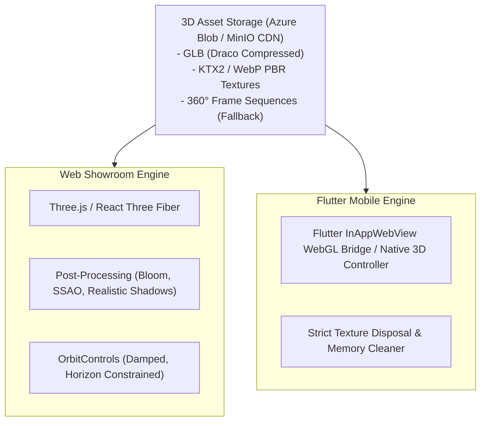
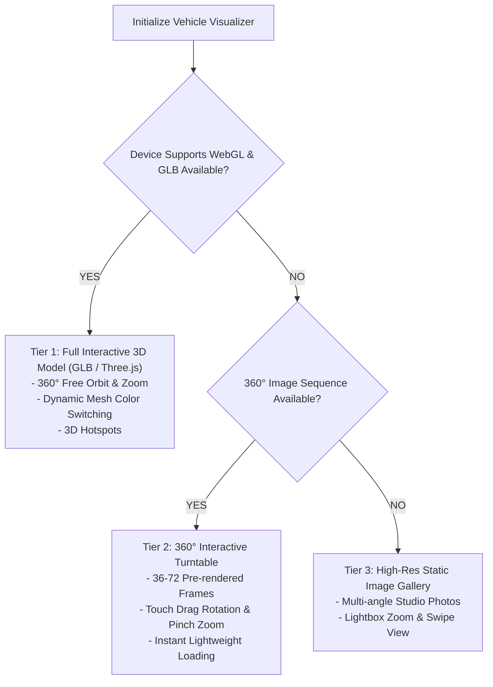

# Interactive 3D Showroom Architecture & Asset Pipeline

This document specifies the architecture, asset pipeline, rendering engines, camera controls, and graceful fallback strategies for the mandatory 3D Vehicle Showroom.

---

## 1. 3D Architectural Vision

The 3D Showroom provides customers with a showroom-grade vehicle inspection experience directly on web portals and mobile applications. Customers can orbit freely around the vehicle, zoom into mechanical components, toggle color shades dynamically, switch variant trims, and tap interactive hotspots (e.g., Dual-Channel ABS, Liquid-Cooled 155cc Engine, TFT Bluetooth Display).

Static photo galleries are strictly non-compliant as the primary visualizer.

---

## 2. Technology Stack & Rendering Architecture

---

## 3. Interactive Capabilities & Camera System

1. **Horizontal Orbit:** Unrestricted 360-degree smooth rotational orbit via mouse drag or touch swipe with inertial damping.
2. **Polar/Elevation Constrained:** Pitch angle clamped between $5^\circ$ (ground level) and $75^\circ$ (top-down view) to prevent disorienting undercarriage clipping.
3. **Pinch-to-Zoom / Wheel Scroll:** Clamped zoom distance ($1.5\text{m}$ minimum close-up to $6.0\text{m}$ overview).
4. **Preset Viewpoint Buttons:** Instant or animated smooth camera slerp to preset angles:
   - Front 3/4 (Hero view)
   - Profile Side (Wheelbase view)
   - Cockpit / Handlebar & Instrument Cluster
   - Rear 3/4 (Exhaust and Tail-lamp view)
5. **Color & Variant Switching:**
   - Swapping paint finishes (e.g., Metallic Blue to Matte Black) dynamically updates material PBR roughness, metalness, and base color textures on mesh nodes without re-downloading geometry or resetting camera position.
6. **Feature Hotspots:**
   - 3D screen-projected HTML markers anchored to vehicle coordinates. Tapping a hotspot presents an overlay card detailing the technical feature with specification metrics.

---

## 4. Multi-Tier Progressive Fallback Strategy

To ensure zero broken screens across legacy smartphones, constrained networks, or unsupported WebGL environments, the visualizer implements a 3-tier fallback pipeline:

---

## 5. Asset Specifications & Optimization Standards

1. **Model Format:** Binary glTF (`.glb`) compliant with glTF 2.0 specification.
2. **Compression:** Draco geometry compression applied to vertex positions, normals, and UVs.
3. **Texture Format:** PBR materials using Basis Universal (`.ktx2`) or WebP texture atlases. Texture dimensions capped at $2048 \times 2048$ for hero paint maps and $1024 \times 1024$ for mechanical details.
4. **Target File Size:** $\le 8\text{MB}$ per vehicle variant model to ensure fast mobile network delivery.
5. **Memory Management:** Textures and WebGL geometries are explicitly disposed (`geometry.dispose()`, `material.dispose()`) when unmounting views to prevent mobile memory leaks.

