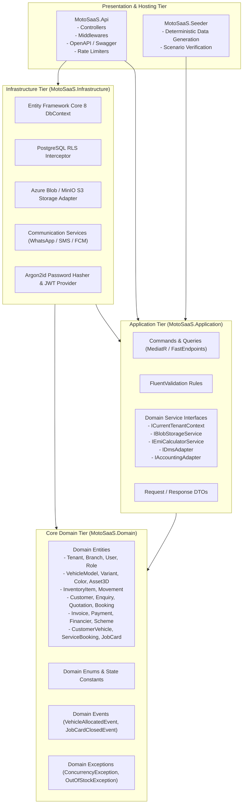
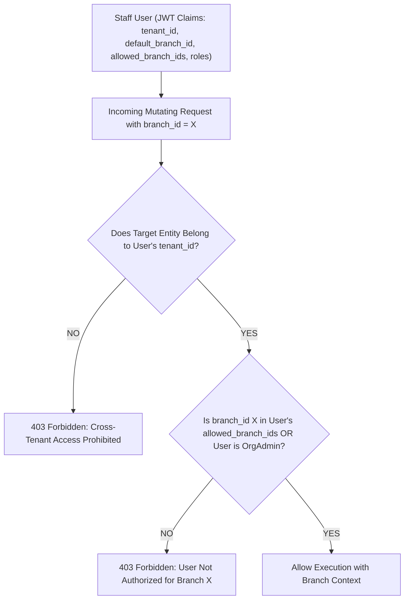

# Detailed System Architecture & Engineering Design Specification (Phase 1)

**Platform:** MotoSaaS (Multi-Tenant Two-Wheeler Dealership Management SaaS)  
**Phase:** Phase 1 — Architecture and Detailed Design  
**Author:** Principal Software Architect & Engineering Lead  
**Last Updated:** 2026-11-13  

---

## 1. Clean Architecture & Module Dependency Graph

The platform is structured as an enterprise-grade **Modular Monolith** adhering to Clean Architecture principles. Dependencies flow inwards toward the core domain entities:



---

## 2. Universal EMI Calculator Engine Specification (Bank-Agnostic)

Per the product direction, the platform provides a completely bank-agnostic mathematical EMI calculator that operates without any dependency on bank credentials or banking APIs, while also supporting dealership-configured financier partner schemes.

### A. Mathematical Formulation

#### 1. Reducing Balance Method (Standard Amortization)
The monthly installment $E$ is given by:
$$E = P \cdot r \cdot \frac{(1 + r)^n}{(1 + r)^n - 1}$$

Where:
- $P = \text{Vehicle On-Road Price} - \text{Down Payment}$ (Principal Loan Amount)
- $r = \frac{\text{Annual Interest Rate (APR)}}{12 \cdot 100}$ (Monthly Periodic Interest Rate)
- $n = \text{Tenure in Months}$ (e.g., 12, 18, 24, 36, 48, 60)

For each month $m \in [1, n]$:
- $\text{Interest Paid}_m = \text{Opening Balance}_m \cdot r$
- $\text{Principal Paid}_m = E - \text{Interest Paid}_m$
- $\text{Closing Balance}_m = \text{Opening Balance}_m - \text{Principal Paid}_m$

#### 2. Flat Rate Method (Fixed Interest on Original Principal)
In certain regional markets, two-wheeler dealers quote flat interest:
$$E_{\text{flat}} = \frac{P + \left(P \cdot \frac{R_{\text{annual}}}{100} \cdot \frac{n}{12}\right)}{n}$$

### B. Financier Partner Scheme Integration
For dealerships with formal finance tie-ups (e.g., TVS Credit, HDFC Bank, L&T Finance):
- Dealership admins configure `financier_schemes` with preset APR, minimum down payment %, maximum Loan-to-Value (LTV %), processing fee (flat or percentage), and documentation charges.
- Customers and sales staff can compare side-by-side:
  `[Standard Mathematical Calculation]` vs `[TVS Credit Special (9.99%)]` vs `[HDFC Zero Down Payment]`.
- Direct attachment of chosen finance scheme to customer Quotations and Bookings.

---

## 3. Role-Based Access Control (RBAC) & Claim Authorization Matrix

The backend enforces strict claim and policy checks on every endpoint:

| Endpoint Resource | Allowed Roles | Branch Context Requirement | Policy Name |
|---|---|---|---|
| `POST /api/v1/auth/customer/*` | Anonymous / Public | None | `AllowAnonymous` |
| `POST /api/v1/auth/staff/login` | Anonymous / Public | Evaluates `DealerCode` | `AllowAnonymous` |
| `GET /api/v1/catalog/*` | Anonymous, Customer, Staff | Optional Tenant Header | `AllowAnonymous` |
| `POST /api/v1/finance/calculate-emi` | Anonymous, Customer, Staff | None (Bank-Agnostic) | `AllowAnonymous` |
| `GET /api/v1/finance/schemes` | Anonymous, Customer, Staff | Resolved Tenant Context | `AllowAnonymous` |
| `POST /api/v1/sales/enquiries` | Anonymous, Customer, Staff | Requires `branch_id` | `AllowAnonymous` / `CustomerOnly` |
| `GET /api/v1/sales/enquiries` | Sales Executive, Branch Manager, Org Admin | Caller's Branch / All Branches | `StaffOnly` + `RequireSalesAccess` |
| `POST /api/v1/sales/quotations` | Sales Executive, Branch Manager | Caller's Branch | `StaffOnly` + `RequireSalesAccess` |
| `POST /api/v1/sales/bookings` | Sales Executive, Cashier, Branch Manager | Caller's Branch | `StaffOnly` + `RequireSalesAccess` |
| `POST /api/v1/inventory/receive` | Branch Manager, Org Admin | Caller's Branch | `StaffOnly` + `RequireInventoryAccess` |
| `POST /api/v1/inventory/allocate` | Sales Executive, Branch Manager | Caller's Branch (Row-Lock) | `StaffOnly` + `RequireAllocationAccess` |
| `POST /api/v1/billing/payments` | Cashier, Branch Manager | Caller's Branch | `StaffOnly` + `RequireCashierAccess` |
| `POST /api/v1/billing/invoices/generate` | Cashier, Branch Manager | Caller's Branch | `StaffOnly` + `RequireCashierAccess` |
| `POST /api/v1/service/job-cards` | Service Advisor, Branch Manager | Caller's Branch | `StaffOnly` + `RequireServiceAccess` |
| `PUT /api/v1/service/job-cards/{id}/assign` | Service Advisor, Branch Manager | Caller's Branch | `StaffOnly` + `RequireServiceAccess` |
| `PUT /api/v1/service/job-cards/{id}/progress` | Service Technician, Service Advisor | Assigned Job Card Only | `StaffOnly` + `RequireTechnicianAccess` |
| `POST /api/v1/admin/tenants` | SaaS Super Admin | Global Platform | `SuperAdminOnly` |

---

## 4. Branch Access & Multi-Branch Governance Model



---

## 5. 3D Vehicle Asset Pipeline & Optimization Standards

1. **Asset Ingestion Pipeline:**
   - OEM/3D Designer uploads GLB file to `POST /api/v1/admin/assets-3d`.
   - Asset validation pipeline checks:
     - glTF 2.0 conformance using automated validator.
     - Maximum file size $\le 12\text{MB}$ uncompressed.
     - Presence of Draco mesh compression.
     - PBR texture map dimensions ($2048 \times 2048$ hero diffuse/normal/roughness).
2. **Camera Preset Schema:**
   ```json
   {
     "heroView": { "position": [2.4, 1.2, 2.4], "target": [0, 0.6, 0], "fov": 45 },
     "profileView": { "position": [3.2, 0.8, 0.0], "target": [0, 0.6, 0], "fov": 40 },
     "cockpitView": { "position": [0.0, 1.3, -0.4], "target": [0, 1.0, 0.2], "fov": 50 },
     "rearView": { "position": [-2.2, 1.0, -2.0], "target": [0, 0.6, 0], "fov": 45 }
   }
   ```
3. **Hotspot Annotation Schema:**
   ```json
   [
     {
       "id": "hotspot-abs",
       "title": "Dual-Channel ABS",
       "description": "Prevents wheel lock-up during hard braking on wet roads.",
       "worldPosition": [0.15, 0.35, 1.1]
     },
     {
       "id": "hotspot-engine",
       "title": "Liquid-Cooled 155cc 4V Engine",
       "description": "Produces 18.4 PS of power with Variable Valve Actuation (VVA).",
       "worldPosition": [0.0, 0.45, 0.1]
     }
   ]
   ```

