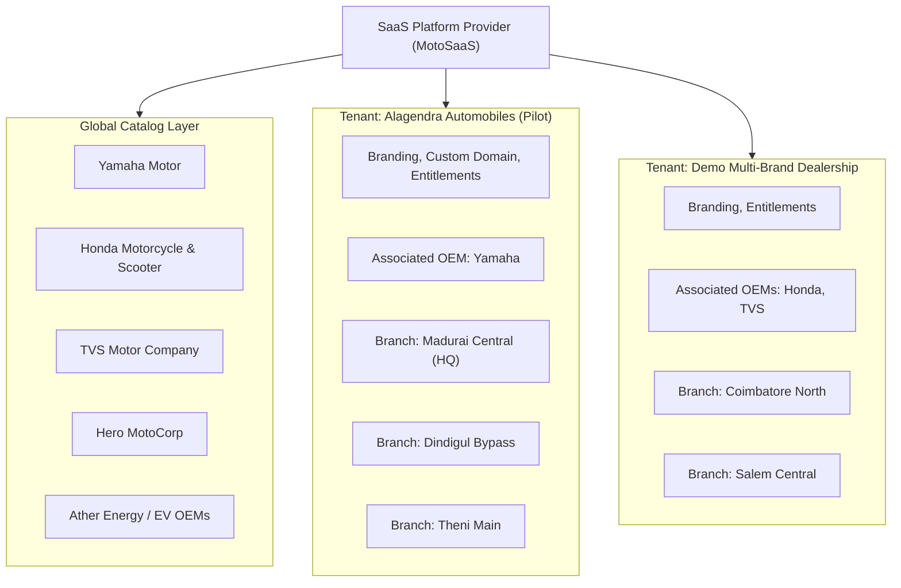
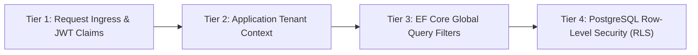

# Tenancy Architecture & Data Isolation Specification

This document details the multi-tenant architecture, isolation guarantees, and operational hierarchy of the MotoSaaS platform.

---

## 1. Tenancy Hierarchy



---

## 2. Entity Decoupling Principles

### A. Manufacturer vs Dealership Organization (Tenant)
- `Manufacturer` represents an Original Equipment Manufacturer (OEM). It owns the global vehicle master catalog, base specifications, variant definitions, factory color codes, and official 3D GLB assets.
- `Tenant` represents an independent dealership group (e.g., Alagendra Automobiles). A tenant can be authorized to sell one or multiple OEM brands via `tenant_manufacturers`.
- The platform never assumes a 1:1 coupling between tenant and manufacturer.

### B. Tenant vs Branch
- A tenant owns legal contracts, billing configuration, subscription entitlements, and global employee rosters.
- A `Branch` is a physical showroom or service center with a specific geographic location, inventory yard, service bays, and assigned staff members.
- Operational records (e.g., physical stock, daily cash receipts, job cards) are branch-scoped (`branch_id`).

---

## 3. Defense-in-Depth Data Isolation

MotoSaaS implements a four-tier isolation model:



1. **Tier 1 (Token Integrity):** All authenticated requests carry an encrypted, signed JWT with `tenant_id`, `branch_id`, and `role` claims.
2. **Tier 2 (Tenant Context Resolution):** `TenantContextMiddleware` populates an ambient `ICurrentTenantContext` scoped service. Request body parameters purporting to set `tenant_id` are rejected or overwritten.
3. **Tier 3 (EF Core Global Filters):** Every EF Core repository automatically appends `WHERE tenant_id = @currentTenantId` to all query expressions:
   ```csharp
   protected override void OnModelCreating(ModelBuilder modelBuilder)
   {
       base.OnModelCreating(modelBuilder);
       foreach (var entityType in modelBuilder.Model.GetEntityTypes())
       {
           if (typeof(ITenantScopedEntity).IsAssignableFrom(entityType.ClrType))
           {
               modelBuilder.Entity(entityType.ClrType)
                   .HasQueryFilter(CreateTenantFilter(entityType.ClrType));
           }
       }
   }
   ```
4. **Tier 4 (PostgreSQL Row-Level Security):** As defense-in-depth against ad-hoc queries, database scripts, or developer mistakes, PostgreSQL enforces row security:
   ```sql
   CREATE POLICY tenant_isolation ON inventory_items
       FOR ALL
       USING (tenant_id = NULLIF(current_setting('app.current_tenant_id', true), '')::UUID);
   ```

---

## 4. Cross-Tenant Test Suite Verification

Every build executes automated isolation tests asserting:
1. `GET /api/v1/inventory` by Tenant A user returns 0 records belonging to Tenant B.
2. Direct attempt to fetch `/api/v1/sales/quotations/{tenant_b_id}` yields `404 Not Found` or `403 Forbidden`.
3. Database level attempt to insert `inventory_item` with mismatched `tenant_id` fails foreign key / RLS check.

