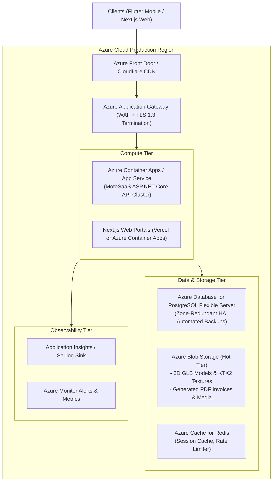

# DevOps, Cloud Deployment & Observability Architecture

This document describes the infrastructure, containerization, cloud deployment architecture, CI/CD pipelines, and disaster recovery procedures for MotoSaaS.

---

## 1. Cloud Architecture on Microsoft Azure

---

## 2. Environment Matrix

| Environment | Purpose | Hosting Setup | Database | Seeder Behavior |
|---|---|---|---|---|
| **Local Development** | Developer local iteration | Docker Compose (API + Postgres + MinIO) | Local PostgreSQL 16 container | Runs full deterministic seeder on start |
| **Staging / Demo** | Client demonstrations & QA | Azure Container Apps (Single replica) | Azure PG Flexible Server (Burstable) | Runs demo seeder with reset endpoint |
| **Production** | Live commercial dealerships | Azure Container Apps (Auto-scaling 2-10 replicas) | Azure PG Flexible Server (General Purpose HA) | Seeder strictly disabled; Schema migrations only |

---

## 2b. Zero-Cost ($0) Azure Deployment Architecture Guide

To host MotoSaaS with **zero ongoing cloud costs ($0/month)** on Microsoft Azure for development, staging, and initial pilot evaluations:

### 1. Compute Tier (ASP.NET Core Web API): $0.00 / month
- **Option A (Azure App Service F1 Free Tier):**
  - SKU: `F1 (Free)` Linux or Windows.
  - Specs: 1 GB RAM, 60 CPU minutes/day.
  - Cost: **$0.00 forever**.
  - Setup: Deploy directly via GitHub Actions or Azure CLI (`az webapp up --sku F1`).
- **Option B (Azure Container Apps - Serverless Scale-to-Zero):**
  - Specs: Free monthly consumption grant includes **180,000 vCPU-seconds + 360,000 GiB-seconds + 2,000,000 HTTP requests** every month.
  - Behavior: Automatically scales down to 0 replicas when no traffic arrives.
  - Cost: **$0.00 / month** within the free grant allowance.

### 2. Database Tier (PostgreSQL): $0.00 / month
- **Option A (Azure Database for PostgreSQL Flexible Server - 12 Months Free):**
  - SKU: Burstable `B1ms` (1 vCPU, 2 GB RAM, 32 GB Storage).
  - Included with Azure Free Account for the first 12 months (750 hours/month = 100% free).
- **Option B (Serverless PostgreSQL Managed Free Tier - Permanent Zero Cost):**
  - Providers: Neon.tech, Supabase, or Render Free PostgreSQL.
  - Connection: Standard PostgreSQL connection string seamlessly compatible with Npgsql and EF Core in `appsettings.json`.
  - Cost: **$0.00 forever** with zero code changes.

### 3. Object & Media Storage (3D GLB Models & Invoices): $0.00 / month
- **Azure Blob Storage (Hot LRS):**
  - 5 GB LRS storage + 20,000 read operations included free for 12 months with Azure Free Account.
  - Alternately, host static 3D GLB assets in `/wwwroot` inside the App Service for permanent $0 cost.

### 4. Web Portals (Branch, Org Admin, Super Admin): $0.00 / month
- **Azure Static Web Apps (Free Plan):**
  - 100 GB bandwidth/month, custom domains, automated free SSL certificate, global CDN distribution.
  - Cost: **$0.00 forever**.

---

## 3. Database Migration & Rollback Strategy

1. **Idempotent EF Core Migrations:** Migrations are applied via automated pipeline scripts during deployment (`dotnet ef database update --idempotent`).
2. **Blue-Green & Zero-Downtime:** Additive schema migrations (e.g., adding nullable columns, new tables) run before new container versions are routed live traffic.
3. **Automated Point-in-Time Recovery (PITR):** Azure PostgreSQL provides 35-day automated point-in-time recovery and geo-redundant backups.
4. **Health Check Probes:**
   - Liveness probe: `/health/live` (verifies process responsiveness).
   - Readiness probe: `/health/ready` (verifies database connectivity and storage mount).

