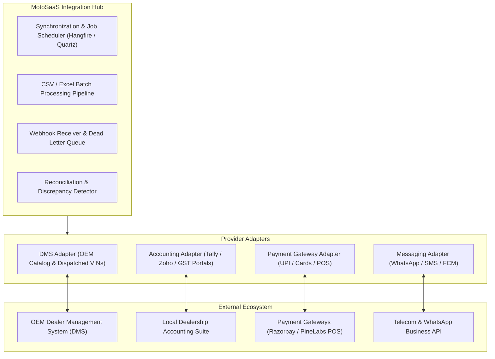

# Integration Architecture & Discovery Framework

This document outlines the provider-independent integration framework, discovery protocol, synchronization strategies, and error-handling mechanisms for external dealership ecosystems.

---

## 1. Guiding Integration Principles

1. **Provider-Independent Abstraction:** Dealerships integrate with a wide variety of OEM systems (Yamaha, Honda, TVS DMS) and local accounting software (Tally Prime, Zoho Books, SAP). The core platform interacts strictly via generic domain interfaces (`IDmsAdapter`, `IAccountingAdapter`, `IPaymentGatewayAdapter`, `ICommunicationAdapter`).
2. **Zero Premature Assumptions:** We do NOT invent proprietary OEM APIs or reverse-engineer private protocols. External interfaces are discovered via dealership onboarding discovery questionnaires.
3. **Primary System of Engagement:** MotoSaaS serves as the modern cloud system of engagement for customers, mobile staff, and digital showrooms, synchronizing asynchronously with upstream enterprise systems of record.
4. **Idempotency & Reconciliations:** All batch syncs and webhook receivers utilize deduplication keys (`Idempotency-Key` / External Transaction IDs) to prevent duplicate invoice posting or stock creation.

---

## 2. Integration Modalities & Adapters

---

## 3. Discovered Data Domain Interfaces

### A. Inventory & Dispatched Chassis Ingestion (`IDmsAdapter`)
- **Direction:** External OEM $\rightarrow$ MotoSaaS
- **Methods:** REST Webhook or Scheduled Hourly Pull or Daily CSV Upload
- **Data Payload:** Dispatched VINs/Chassis numbers, Engine numbers, Model codes, Factory color codes, Invoice date, Carrier transit status.

### B. Financial Journal & Invoicing Export (`IAccountingAdapter`)
- **Direction:** MotoSaaS $\rightarrow$ Accounting Suite
- **Methods:** Automated nightly sync or on-demand JSON/XML/CSV journal export.
- **Data Payload:** Vehicle sales invoices, service invoices, customer GSTIN, tax breakup (CGST, SGST, IGST), ledger account codes.

### C. Customer Communication (`ICommunicationAdapter`)
- **Direction:** MotoSaaS $\rightarrow$ Customer Device
- **Methods:** Direct HTTPS API calls with automatic retry and exponential backoff.
- **Data Payload:** OTP verification tokens, test ride confirmations, quotation PDFs, service estimate approval links, gate pass QR codes.

---

## 4. Error Handling & Retry Policies

1. **Dead Letter Queue (DLQ):** Failed synchronization events are stored in `integration_audit_logs` with the complete raw payload, HTTP status code, and exception stack trace.
2. **Exponential Backoff:** Retried at 1 min, 5 min, 30 min, and 2 hours intervals before alerting branch managers.
3. **Manual Override & Conflict Resolution:** Dealership administrators can review flagged discrepancies (e.g., chassis received in DMS but missing in physical yard) and resolve via a web reconciliation console.

