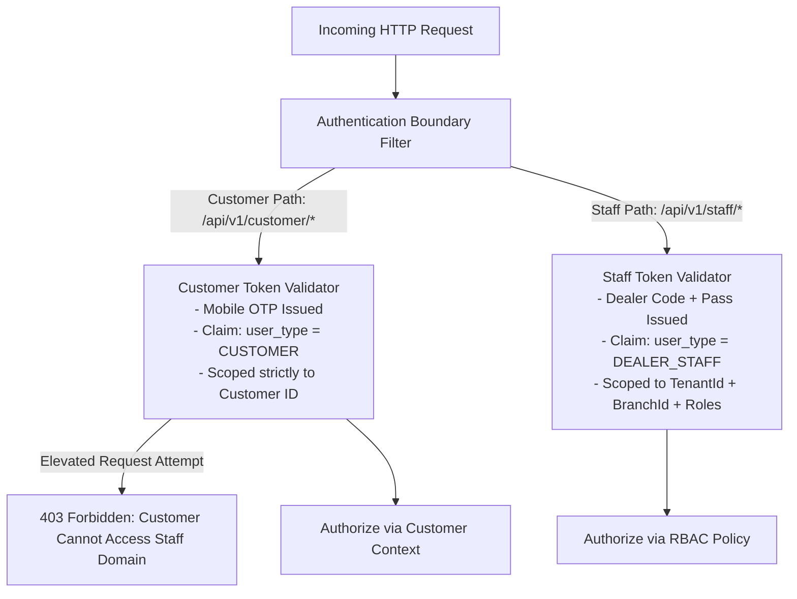

# Security Architecture, Threat Modeling & Risk Controls

This document details the security architecture, threat model, access control policies, and risk mitigations for the MotoSaaS platform.

---

## 1. Authentication & Identity Boundaries

MotoSaaS enforces a non-negotiable architectural separation between Customer and Staff identities.

### Key Controls
1. **Zero Privilege Elevation:** A customer JWT token attempting to call `/api/v1/staff/*` or `/api/v1/inventory/*` is immediately rejected by ASP.NET Core authorization policies (`[Authorize(Policy = "StaffOnly")]`).
2. **Password & Token Security:**
   - Staff passwords hashed with Argon2id or BCrypt ($work\_factor \ge 12$).
   - Short-lived Access Tokens (15 minutes) paired with cryptographically secure, rotating Refresh Tokens (7 days) stored in PostgreSQL with family-revocation detection.
3. **OTP Security:**
   - OTPs generated using secure CSPRNG (6 digits).
   - Rate limited to 3 requests per 10 minutes per phone number/IP.
   - Maximum lifetime of 5 minutes; auto-invalidated after 3 failed verification attempts.

---

## 2. Authorization & Role-Based Access Control (RBAC)

| Role | Scope | Key Permissions |
|---|---|---|
| **SaaS Super Admin** | Global Platform | Tenant provisioning, global manufacturer catalog, subscription plans, platform audit logs |
| **Org Admin** | Tenant Wide | Branch management, staff role assignment, pricing policies, promotions, consolidated reports |
| **Branch Manager** | Branch Assigned | Branch inventory approvals, staff activity monitoring, discount approvals, cashier reconciliation |
| **Sales Executive** | Branch Assigned | Lead processing, test ride scheduling, quotation creation, booking conversion |
| **Service Advisor** | Branch Assigned | Vehicle reception, job card creation, parts/labour estimate generation, vehicle delivery |
| **Service Technician** | Branch Assigned | Assigned job card execution, inspection checklist input, spare parts requisitions |
| **Cashier / Billing** | Branch Assigned | Payment collection, invoice sealing, payment receipt generation, gate pass issuance |
| **Customer** | Self Only | Vehicle browsing, enquiry submission, own vehicle ownership view, service booking |

---

## 3. Threat Modeling & Risk Mitigation Matrix

| Threat Category | Potential Attack Vector | Platform Countermeasure |
|---|---|---|
| **Cross-Tenant Data Leakage** | Malicious or buggy query omitting `tenant_id` filter | 1. EF Core Global Query Filter on all `ITenantScopedEntity`. 2. PostgreSQL Row-Level Security (RLS) policies checking `app.current_tenant_id`. 3. Automated multi-tenant integration test suite. |
| **Branch Privilege Escalation** | Sales executive from Branch A modifies inventory in Branch B | Server-side validation matching entity `branch_id` against the caller's JWT `branch_id` claim in all command handlers. |
| **Chassis Double-Allocation Race** | Concurrent requests allocate the same chassis to two buyers | Row-level locking (`SELECT ... FOR UPDATE`) in serializable DB transactions during chassis allocation. |
| **Mobile Shared Device Leakage** | Staff user logs out; customer mode uses retained tokens | `PurgeSessionUseCase` purges Flutter Secure Storage keys, SQLite caches, and Dio in-memory headers upon logout or mode switch. |
| **Sensitive Data Exposure** | Plaintext PII or payment tokens in server logs | Serilog masking filters for mobile numbers, passwords, OTPs, and payment transaction tokens. |

