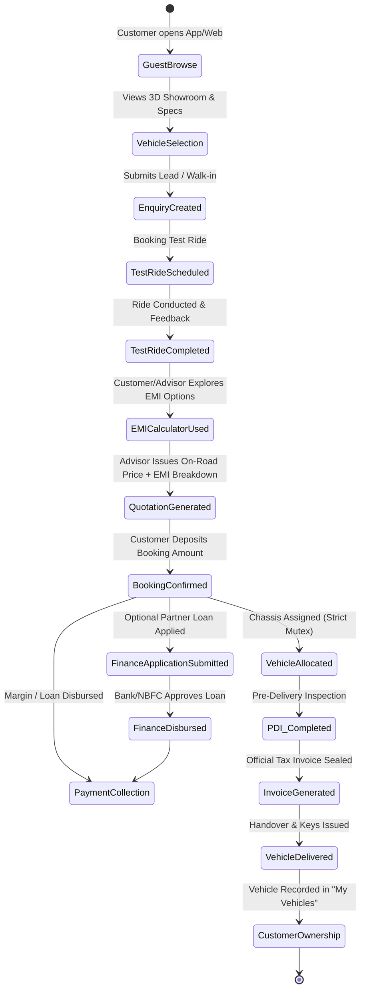
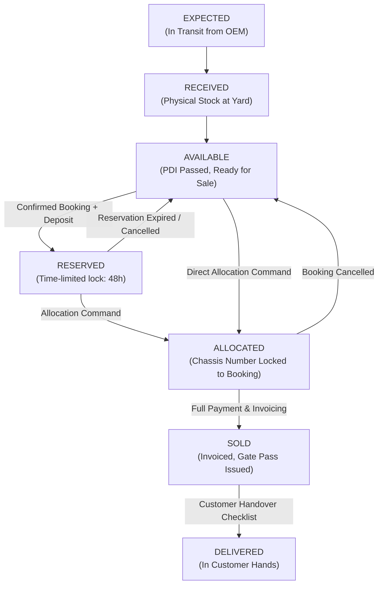

# Sales & Vehicle Delivery Lifecycle Workflow

This document specifies the complete business process, state transitions, validation rules, and transactional boundaries for the vehicle sales journey.

---

## 1. End-to-End Sales State Machine



---

## 2. Distinct Business Entities & Boundaries

Per the non-negotiable product principles, these entities remain strictly decoupled:

| Entity | Purpose | Inventory Impact | Financial Impact |
|---|---|---|---|
| **Enquiry** | Captures customer purchase intent and contact info | None | None |
| **Test Ride** | Governs vehicle trial appointment and DL verification | Test fleet only | None |
| **Quotation** | Estimates on-road price (ex-showroom + RTO + insurance + accessories - discount) | None | None (Proposal only) |
| **Booking** | Legally binding agreement backed by deposit | Reserves variant quota | Records initial deposit |
| **Vehicle Allocation** | Locks specific chassis number (VIN) to booking | Status: `Available` -> `Allocated` | None |
| **Invoice** | Sealed legal tax document with GSTIN and tax breakup | Status: `Allocated` -> `Sold` | Finalizes receivable ledger |
| **Delivery Handover** | Physical vehicle release with battery/tool checklist | Status: `Sold` -> `Delivered` | None |
| **Customer Ownership** | Digital asset registered in customer profile for after-sales | Linked to customer profile | Enables service warranty |

---

## 3. Inventory State Transitions & Allocation Concurrency



### Critical Concurrency Rule: Zero Double-Allocation
Allocation of an `inventory_item` to a `booking` MUST execute inside a database transaction with serializable isolation or an explicit row lock:
```csharp
await using var transaction = await _dbContext.Database.BeginTransactionAsync(IsolationLevel.ReadCommitted);
var item = await _dbContext.InventoryItems
    .FromSqlInterpolated($"SELECT * FROM inventory_items WHERE id = {itemId} AND status = 'AVAILABLE' FOR UPDATE")
    .SingleOrDefaultAsync();

if (item == null)
    throw new ConcurrencyException("Vehicle chassis is no longer available for allocation.");

item.Status = InventoryStatus.Allocated;
booking.AllocatedInventoryId = item.Id;
booking.Status = BookingStatus.Allocated;

await _dbContext.SaveChangesAsync();
await transaction.CommitAsync();
```
An enquiry or quotation NEVER locks or modifies inventory stock.

