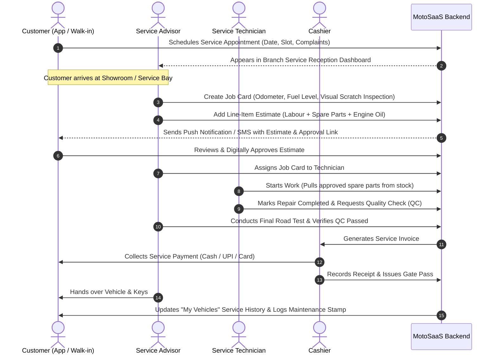

# Service & Workshop Management Workflow

This document details the operational flow, roles, inspection checklists, and billing rules for two-wheeler after-sales service.

---

## 1. End-to-End Service Lifecycle

---

## 2. Job Card State Transitions

```mermaid
stateDiagram-v2
    [*] --> OPEN: Vehicle Received by Advisor
    OPEN --> ESTIMATED: Parts & Labour Estimate Calculated
    ESTIMATED --> APPROVED: Customer Grants Digital/Manual Approval
    APPROVED --> ASSIGNED: Assigned to Bay Technician
    ASSIGNED --> WORK_IN_PROGRESS: Technician Commences Repair
    WORK_IN_PROGRESS --> QC_PENDING: Work Complete; Road Test Required
    QC_PENDING --> QC_PASSED: Quality Inspector Passes Vehicle
    QC_PASSED --> BILLED: Cashier Generates Invoice
    BILLED --> CLOSED: Payment Received & Gate Pass Issued
    CLOSED --> [*]
```

---

## 3. Vehicle Reception & Inspection Checklist

When checking in a two-wheeler, the Service Advisor records:
1. **Odometer Reading:** Recorded in kilometers; validated against previous service history (must be $\ge$ previous reading).
2. **Fuel Level:** Stored as percentage or segment bar (0%, 25%, 50%, 75%, 100%).
3. **Physical Condition:** Interactive touch diagram recording exterior scratches, dents, or broken indicators.
4. **Accessories & Belongings:** Toolkit present (Yes/No), First Aid Kit present (Yes/No), Left/Right Mirrors intact (Yes/No), Helmet stored (Yes/No).
5. **Customer Complaints:** Tagged with categorized issues (e.g., Engine Noise, Brake Squeal, Low Mileage, Chain Slack).

